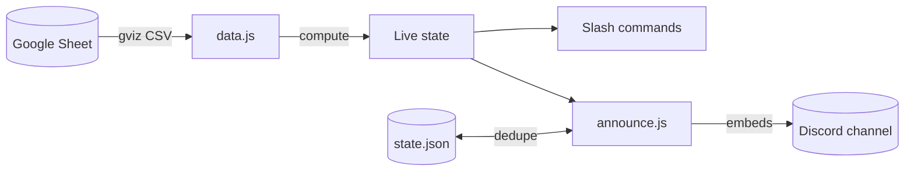

# AWO Hunt Tracker

> Discord bot for the **Alpha Wolves [AWO]** *Total Battle* clan — live slash commands and smart announcements powered by the same Google Sheet as the hunt dashboard.

<p align="center">
  <a href="LICENSE"></a>
  <a href="https://nodejs.org/"></a>
  <a href="https://discord.js.org/"></a>
  
  
</p>

Numbers are computed with the **exact parse/compute logic** ported from the dashboard, so the bot and the site never disagree.

---

## Features

| | |
|---|---|
| **Slash commands** | Query leaderboard, player stats, clan goal, and top chest sources on demand |
| **Smart announcements** | Post only when the sheet’s *Updated* timestamp advances — no spam |
| **Cycle-aware** | Resets state on new hunt windows; final standings when a cycle closes |
| **Persistent state** | Tracks milestones, daily recaps, and last snapshot via JSON |
| **Zero privileged intents** | Guilds intent only — no message content or member scraping |

---

## Slash commands

| Command | Description |
|---------|-------------|
| `/leaderboard [count]` | Top hunters by points (default **10**, max 25) |
| `/player <name>` | A hunter’s points, chests, pace, status, rank, and top sources — partial name match |
| `/goal` | Clan progress toward the point goal, pace verdict, days left |
| `/chests [count]` | Top scoring chest/event sources (default **8**, max 15) |

---

## Announcements

Posted to `CHANNEL_ID` when configured. The bot polls every `POLL_MINUTES` (default **15**) and announces **only on new sheet data**.

| Trigger | What gets posted |
|---------|------------------|
| **Sheet update** | Top movers — who scored new chests since the last sync |
| **Goal milestones** | Clan crosses **25% / 50% / 75% / 100%** of the point goal |
| **Daily recap** | Top 10 standings once per UTC day (default **17:00 UTC**) |
| **Cycle end** | Final standings when the hunt window closes |

---

## How it works



1. **`src/data.js`** fetches three tabs — summary, chest matrix, and point weights — and computes clan/hunter metrics.
2. **`src/commands.js`** serves slash commands with rich embeds from **`src/format.js`**.
3. **`src/announce.js`** compares fresh state against persisted **`src/state.js`** and decides what (if anything) to post.
4. **`src/index.js`** runs the Discord client and the announcement scheduler.

---

## Quick start

### 1. Create the Discord application

1. Open the [Discord Developer Portal](https://discord.com/developers/applications) → **New Application**.
2. **Bot** tab → copy the token → `DISCORD_TOKEN`.
3. **General Information** → copy **Application ID** → `APP_ID`.
4. **OAuth2 → URL Generator** — scopes: `bot` + `applications.commands`  
   Bot permissions: *Send Messages*, *Embed Links*.  
   Open the generated URL and invite the bot to your server.
5. Enable **Developer Mode** in Discord (Settings → Advanced).
   - Right-click your server → **Copy Server ID** → `GUILD_ID`
   - Right-click the announcement channel → **Copy Channel ID** → `CHANNEL_ID`

No privileged gateway intents are required.

### 2. Configure environment

```bash
cp .env.example .env
# Edit .env — at minimum set DISCORD_TOKEN, APP_ID, GUILD_ID, CHANNEL_ID
```

### 3. Install, register commands, and run

```bash
npm install
npm run register   # re-run only when command definitions change
npm start
```

---

## Environment variables

| Variable | Required | Default | Description |
|----------|----------|---------|-------------|
| `DISCORD_TOKEN` | ✅ | — | Bot token from the Developer Portal |
| `APP_ID` | ✅ | — | Application ID (for command registration) |
| `GUILD_ID` | recommended | — | Server ID — guild commands update instantly |
| `CHANNEL_ID` | for announcements | — | Channel for scheduled posts; omit for slash-only mode |
| `SHEET_ID` | | built-in AWO sheet | Google Sheet ID to read |
| `POLL_MINUTES` | | `15` | Announcement poll interval |
| `STATE_FILE` | | `./state.json` | Path for announcement dedupe state |
| `MOVERS_TOP` | | `5` | Max hunters in a movers announcement |
| `MOVERS_MIN_POINTS` | | `1` | Minimum point delta to count as a mover |
| `DAILY_UTC_HOUR` | | `17` | UTC hour for the daily top-10 recap |

---

## Hosting

The bot is a **long-running Node process** (persistent Discord gateway). It needs an always-on host — not GitHub Actions or static site hosts.

| Platform | Notes |
|----------|-------|
| **[Railway](https://railway.app/) / [Render](https://render.com/)** | Connect the repo, set env vars, deploy. Mount a volume and set `STATE_FILE=/data/state.json` so state survives restarts. |
| **[Fly.io](https://fly.io/)** | `fly launch` (uses the included `Dockerfile`), `fly secrets set …`, attach a volume at `/data`. |
| **VPS / home server** | `npm install && npm start` under [pm2](https://pm2.keymetrics.io/) or systemd. |

> **State note:** Without a persistent volume, `state.json` resets on every redeploy. Harmless, but you may see a repeat milestone post after a restart. Set `STATE_FILE` on a mounted volume to avoid that.

### Docker

```bash
docker build -t awo-hunt-bot .
docker run --env-file .env -v awo-state:/data \
  -e STATE_FILE=/data/state.json \
  awo-hunt-bot
```

---

## Project structure

```
.
├── src/
│   ├── index.js       Discord client + announcement scheduler
│   ├── register.js    One-off slash command registration
│   ├── commands.js    Slash command definitions + handlers
│   ├── data.js        Sheet fetch, CSV parse, metric compute
│   ├── format.js      Discord embed builders
│   ├── announce.js    Announcement rules (movers, milestones, recaps)
│   └── state.js       JSON persistence for dedupe state
├── Dockerfile         Production container image
└── .env.example       Environment template
```

---

## Extending

- **New slash command** — add a builder + handler case in `src/commands.js`, an embed in `src/format.js`, then `npm run register`.
- **New announcement** — add an embed in `src/format.js` and a rule in `src/announce.js`.
- **Idle / behind-pace nudges** — `compute()` already tags players as `idle`, `lag`, or `hunt`; wire a rule in `src/announce.js` if you want automated callouts.

---

## License

[MIT](LICENSE) © Summit Fortress Investments - Nevis IBC
